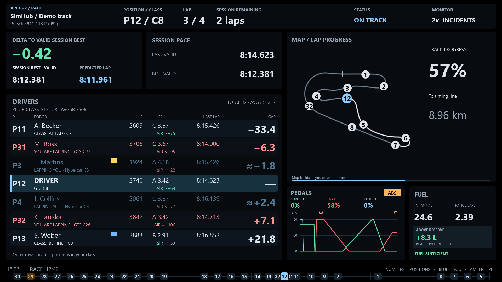
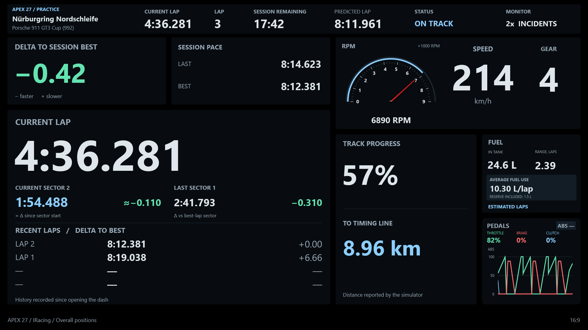
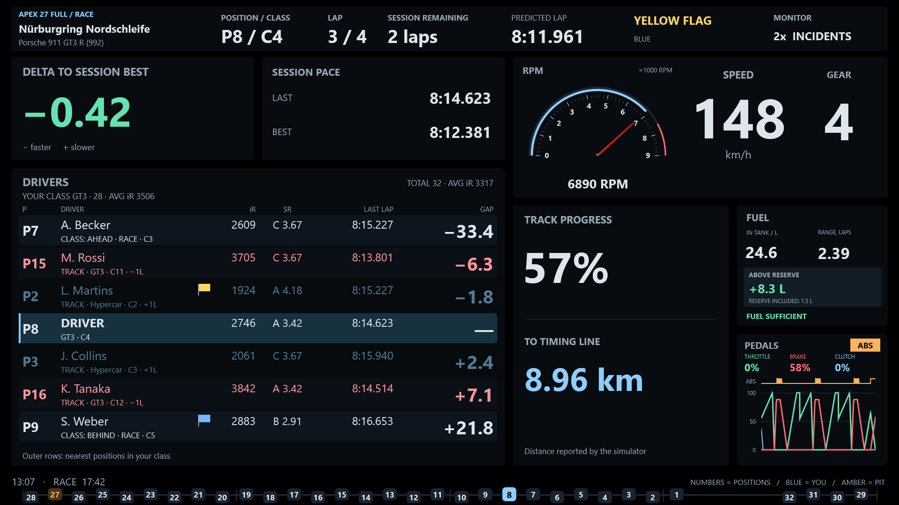

# APEX 27

A free SimHub dashboard for a dedicated 16:9 fourth monitor. The 1920 × 1080 layout brings together lap timing, nearby traffic, a track map, fuel information and pedal history. Race, practice and qualifying views adapt to the session and available telemetry. Choose a companion layout for existing wheel or external displays, or Full with driving instruments on screen.

[Download](https://github.com/Lord-of-the-Bots/apex27/releases/latest) · [Installation](INSTALL.md) · [Report a bug or suggest a change](https://github.com/Lord-of-the-Bots/apex27/issues)

## Two variants

| Variant | Purpose |
| --- | --- |
| **APEX 27** | For rigs with RPM, gear and flag indicators on the wheel or external displays. A large square map, wide pedal graphs and compact fuel panel use the space; RPM, gear and the general flag panel are omitted in every session mode. |
| **APEX 27 Full** | For rigs that need driving instruments on screen. Includes an analogue tachometer, speed, gear and top-row flags alongside lap timing, traffic, a square map, fuel and pedal history. |

Both variants retain automatic session views, lap prediction, the field ribbon, ratings and individual opponent flags where telemetry allows. Both include all 13 languages. They install separately and keep separate settings. Importing an update replaces the matching dashboard.

## Features

- **Full driving instruments:** an analogue tachometer, speed and gear in the upper-right panel, with general flags in the top row. Both variants support pit speed information when available.
- **Lap timing:** compact lap times and a predicted lap time in a consistent position across race, practice and qualifying views.
- **Practice and qualifying:** current lap and sector timing replaces the race table. Completed-sector comparison uses the matching sector from the best complete lap of the session; the full-lap delta remains separate.
- **Multiclass traffic:** the closest rivals ahead and behind in your class occupy fixed table rows, with nearby track traffic and your car between them. Labels distinguish race gaps from track intervals. Choose seven rows or five rows with larger text.
- **Field overview:** a bottom ribbon shows cars around the lap when opponent track positions are available. The table includes each driver's last completed lap and individual flags when supplied by the game.
- **iRacing information:** participant iRating, licence/SR, field size and mean iRating for the session and your class. Ratings come from session data; no post-race rating change is predicted.
- **Track map:** a square map beside the table uses SimHub's track geometry and stays visible in the pits. Tyre information or lap progress can take its place when a map is unavailable.
- **Fuel and pedals:** compact fuel information and throttle, brake and clutch history, with ABS activity. The lower-right panel can also show car and tyre information.
- **Display settings:** manual or automatic language selection, standard or dim palette, table text size and lower-right panel choice.

## Games and telemetry

Game-specific handling covers iRacing, Gran Turismo 7, Assetto Corsa, Assetto Corsa Competizione, Assetto Corsa EVO, Assetto Corsa Rally, Le Mans Ultimate, rFactor 2, Automobilista 2, RaceRoom, F1, DiRT Rally and EA WRC. Available panels follow the telemetry supplied by each game.

Panels use the information received by SimHub. Missing times and deltas are shown as a dash. Fuel estimates require usable consumption data. Track maps require geometry saved, loaded or generated by SimHub from telemetry; a missing map does not necessarily indicate a dashboard problem.

Live sector delta tracks the change in lap delta since entering the sector. **≈** marks a telemetry-based estimate. When the dashboard opens mid-sector, this value starts after the next recorded sector boundary. If sector data is unavailable, best and previous lap times remain available.

In multiclass races, other classes are dimmed. Cars a lap ahead are blue; cars a lap behind are red. Fixed class rivals use race gaps, including whole-lap differences such as `1L`; nearby traffic uses track intervals. Mean iRating is an arithmetic mean and is hidden if participant ratings are incomplete.

Individual iRacing flags appear only when the corresponding telemetry is available. A yellow flag is a warning for a participant or their area, not an identification of a crashed car. A session-wide flag is not copied to every participant.

Game-specific behaviour includes:

- **Gran Turismo 7:** position and field size appear in the top row with SimHub 9.13 or newer. These values do not provide an opponent list or determine the session type.
- **F1 2017:** the table shows neighbouring race positions; physical track intervals are not shown.
- **Forza:** fuel is shown as a tank percentage, without refuelling-volume or per-lap consumption calculations.
- **Assetto Corsa EVO:** a card of available telemetry replaces the unsupported track map.
- **Rally:** panels follow the available stage telemetry. Full includes RPM, speed and gear; both variants retain pedal history.

Previews labelled **SimHub / Demo track** use SimHub's built-in demonstration map.

## Languages

English, Russian, German, Spanish, French, Italian, Brazilian Portuguese, Polish, Czech, Turkish, Japanese, Korean and Simplified Chinese.

Choose a language in **Language**. Manual selection needs no plugin and always takes priority. The optional `Apex27LanguagePlugin.dll` lets **Auto — SimHub** follow SimHub's interface language. Auto falls back to English if the bridge is unavailable or the language is unsupported.

## Installation

Requires **SimHub 9.12 or newer** on Windows. GT7 position and field size require **SimHub 9.13 or newer**.

Open `APEX 27.simhubdash` or `APEX 27 Full.simhubdash` and confirm the import in SimHub. Open the dashboard on your 16:9 display and choose its settings.

The `plugins` folder is optional. For **Auto — SimHub**, close SimHub and copy only `plugins/Apex27LanguagePlugin.dll` beside `SimHubWPF.exe`, then restart SimHub and enable **APEX 27 language bridge**. See [INSTALL.md](INSTALL.md) for details.

## Feedback

[Report technical issues on GitHub](https://github.com/Lord-of-the-Bots/apex27/issues) so they can be investigated and fixed. Include the game, SimHub version, dashboard variant and steps to reproduce; a screenshot is helpful where relevant.

Suggestions for the displayed information, layout and element sizes are welcome on GitHub, Reddit or in the comments.

## Build

Run `python src/build.py` to create both dashboard files in `src/dist`. To build the optional language bridge, run `src/language-bridge/build.ps1 -SimHubDir "C:\Program Files (x86)\SimHub"` in PowerShell.

## Support

You can support the project with a crypto donation:

BTC (Bitcoin):
1NbtPNkofnKZRjLpULRjhKuAtbh12DovC9

USDT, TRX (TRC20):
TUgM6hPokF1vPUW8CRp77CgvF3YroabwFP

TON:
UQBLdOWJeVeVg4b0-HkQGNVV8HG6-xWS7moZOUfNBz2-Jf3u

ETH (ERC20):
0x14bba7b8b76ea4743a202bdee2144e4d558ddf93

LTC (Litecoin):
LRRS5YBeqfkYpw2jC2bDAWgpcgm7Wpu6pM
