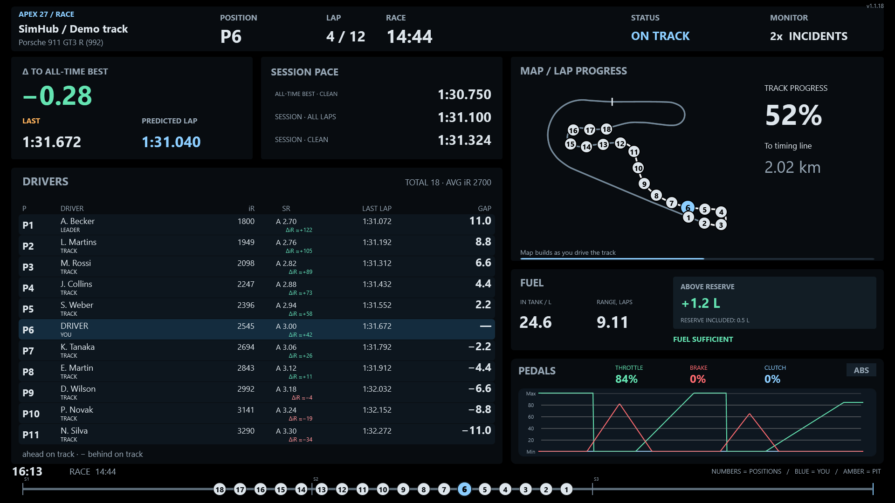
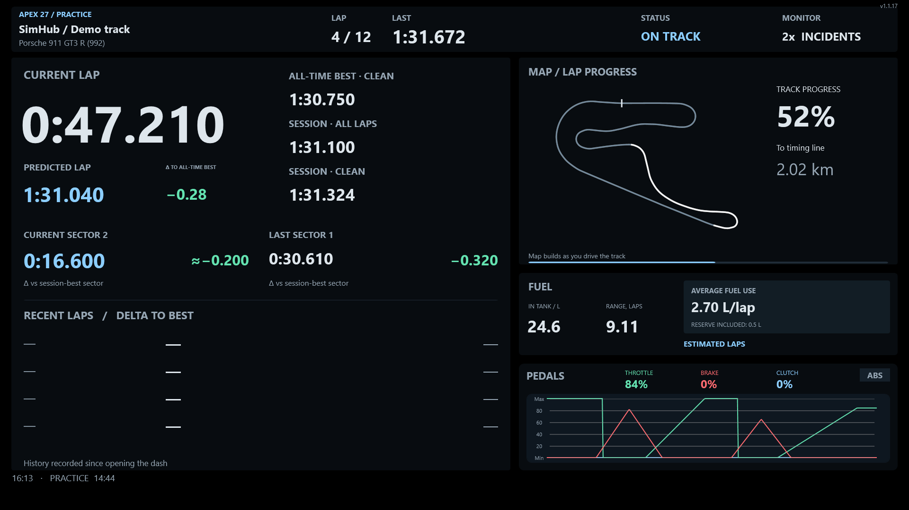
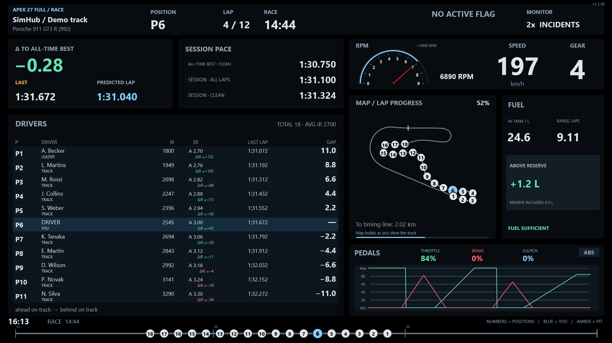

# APEX 27

A free SimHub dashboard for a dedicated 16:9 fourth monitor. The 1920 × 1080 layout brings together lap timing, nearby traffic, a track map, fuel information and pedal history. Race, practice and qualifying views adapt to the session and available telemetry. Choose a companion layout for existing wheel or external displays, or Full with driving instruments on screen.

[Download](https://github.com/Lord-of-the-Bots/apex27/releases/latest) · [Installation](INSTALL.md) · [Report a bug or suggest a change](https://github.com/Lord-of-the-Bots/apex27/issues)

**iRacing is the focus of this release.** Telemetry handling, standings and update performance have been refined and optimized through roughly 20 races with repeated fixes between sessions. Other games have not received the same refinement and testing in this release cycle. Their existing integrations may work where suitable telemetry is available, but their current behaviour is unverified.

The previews below show the current dashboard rendered by SimHub with demonstration data. They illustrate the interface and are not captures from a live race.

## Two variants

| Variant | Purpose |
| --- | --- |
| **APEX 27** | For rigs with RPM, gear and flag indicators on the wheel or external displays. A large square map, wide pedal graphs and compact fuel panel use the space; RPM, gear and the general flag panel are omitted in every session mode. |
| **APEX 27 Full** | For rigs that need driving instruments on screen. Includes an analogue tachometer, speed, gear and top-row flags alongside lap timing, traffic, a square map, fuel and pedal history. |

Both variants retain automatic session views, lap prediction, the field ribbon, ratings and individual opponent flags where telemetry allows. Both include all 13 languages. They install separately and keep separate settings. Importing an update replaces the matching dashboard.

## Features

- **Full driving instruments:** an analogue tachometer, speed and gear in the upper-right panel, with general flags in the top row. Both variants support pit speed information when available.
- **Lap timing:** current, previous and predicted lap times, plus separate all-time personal clean, session inclusive and session clean records. The main iRacing delta uses an available valid all-time reference without waiting for a new session lap; prediction uses an available SimHub reference. Clean records are based on continuously observed laps; they are not an official validity verdict.
- **Practice and qualifying:** a large current lap with prediction and live delta below, alongside the three best-lap records. Sector deltas compare each sector with its independent best in the current session.
- **Multiclass traffic:** the closest rivals ahead and behind in your class occupy fixed table rows, with nearby track traffic and your car between them. Each row has one gap field: race gaps for fixed class rivals and track intervals for nearby traffic. Choose eleven compact rows, seven rows or five rows with larger text. Practice and warmup can show the driver table or the detailed timing view.
- **Field overview:** a bottom ribbon shows cars around the lap when opponent track positions are available. Numbered circles sit at their actual track coordinates on a single rail. Opponents are drawn from last to first place; your larger blue circle is drawn on top. Pit circles are amber. The table includes each driver's last completed lap and individual flags when supplied by the game.
- **iRacing information:** participant iRating, licence/SR, field size and mean iRating for the session and your class. Includes an approximate ΔiR for the current class finishing order when the session status and participant ratings allow it. Eligibility follows the official/unofficial flags supplied by iRacing; the dashboard does not independently determine the minimum field size of each series.
- **Track map:** a square map beside the table uses SimHub's track geometry and stays visible in the pits. Tyre information or lap progress can take its place when a map is unavailable.
- **Fuel and pedals:** compact fuel information and throttle, brake and clutch history using the original 4thMonitor graph with 400 points per channel, plus an ABS activity indicator. The lower-right panel can also show car and tyre information.
- **Display settings:** manual or automatic language selection, standard or dim palette, table text size and lower-right panel choice.
- **Session clock:** local time and the remaining time of the current session phase in the lower-left corner, alongside the field ribbon.

## Games and telemetry

The current refinement and optimization work targets **iRacing**. Existing handling also covers Gran Turismo 7, Assetto Corsa, Assetto Corsa Competizione, Assetto Corsa EVO, Assetto Corsa Rally, Le Mans Ultimate, rFactor 2, Automobilista 2, RaceRoom, F1, DiRT Rally and EA WRC. These other integrations have not been verified in this release cycle. Available panels follow the telemetry supplied by each game.

Panels use the information received by SimHub; the included bridge also reads the local iRacing telemetry feed directly for current race data. Missing times and deltas are shown as a dash. Fuel estimates require usable consumption data. Track maps require geometry saved, loaded or generated by SimHub from telemetry; a missing map does not necessarily indicate a dashboard problem.

Sector references are the independent fastest valid sectors of the current session. Live comparison uses a matching trace recorded while the dashboard is open; **≈** marks interpolation between telemetry samples. The first sector starts at lap time zero. Until a matching valid-lap trace is available, live sector delta shows a dash and a recording notice. Missing sector telemetry does not prevent available lap times from being shown.

In multiclass races, other classes are dimmed. Cars a lap ahead are red; cars a lap behind are blue. Row labels use `+1 lap` for a car ahead and `−1 lap` for a car behind. After your finish, lap colours use the race results or recorded finish crossings rather than cooldown movement. Fixed class rivals use race gaps, including whole-lap differences such as `1L`; nearby traffic uses track intervals. Mean iRating includes all eligible roster entries, including cars in the pits or no longer on track, and is hidden if participant ratings are incomplete.

Individual iRacing flags appear only when the corresponding telemetry is available. A yellow flag is a warning for a participant or their area, not an identification of a crashed car. A session-wide flag is not copied to every participant.

Game-specific behaviour includes:

- **Gran Turismo 7:** position and field size appear in the top row with SimHub 9.13 or newer. These values do not provide an opponent list or determine the session type.
- **F1 2017:** the table shows neighbouring race positions; physical track intervals are not shown.
- **Forza:** fuel is shown as a tank percentage, without refuelling-volume or per-lap consumption calculations.
- **Assetto Corsa EVO:** a card of available telemetry replaces the unsupported track map.
- **Rally:** panels follow the available stage telemetry. Full includes RPM, speed and gear; both variants retain pedal history.

Previews labelled **SimHub / Demo track** use SimHub's built-in demonstration map.

## Languages

English, Russian, German, Spanish, French, Italian, Brazilian Portuguese, Polish, Czech, Turkish, Japanese, Korean and Simplified Chinese.

Choose a language in **Language**. Manual selection always takes priority. **Auto — SimHub** follows SimHub's interface language and falls back to English if it is unsupported.

## Required APEX 27 plugin

`Apex27Plugin.dll` is the dashboard's companion plugin. It reads live iRacing telemetry, supplies the map component and its current position labels, saves observed clean lap records per car and track, and provides SimHub's language for automatic language selection. It reads simulator data without sending driving or pit commands.

The plugin is required for both dashboard variants, including when you choose a language manually or use another game. It was previously named `Apex27LanguagePlugin.dll`; the new name reflects its wider role.

## Installation

Requires **SimHub 9.13.3 or newer** on Windows and the included `Apex27Plugin.dll`.

Download and extract **APEX27-v1.1.14.zip** from the latest release. It contains both dashboards, the required plugin and installation instructions.

Close SimHub. If upgrading, remove the old `Apex27LanguagePlugin.dll` from beside `SimHubWPF.exe`, then copy `plugins/Apex27Plugin.dll` into that folder. Do not keep both plugins installed. Restart SimHub and enable **APEX 27 bridge**, then import either file from `dashboards`. Update the dashboard and plugin together: older dashboards still refer to the old plugin name. Open the updated dashboard on your 16:9 display. See [INSTALL.md](INSTALL.md) for details.

## Feedback

[Report technical issues on GitHub](https://github.com/Lord-of-the-Bots/apex27/issues) so they can be investigated and fixed. Include the game, SimHub version, dashboard variant and steps to reproduce; a screenshot is helpful where relevant.

Suggestions for the displayed information, layout and element sizes are welcome on GitHub, Reddit or in the comments.

## Build

Build the required plugin with `src/plugin/build.ps1 -SimHubDir "C:\Program Files (x86)\SimHub"` in PowerShell, then run `python src/build.py --release`. This creates both dashboard files, the plugin, instructions and previews under `releases`, plus the versioned ZIP for publication. To rebuild only the dashboard files, run `python src/build.py`.

## Support

You can support the project with a crypto donation:

BTC (Bitcoin):
1NbtPNkofnKZRjLpULRjhKuAtbh12DovC9

USDT, TRX (TRC20):
TUgM6hPokF1vPUW8CRp77CgvF3YroabwFP

TON:
UQBLdOWJeVeVg4b0-HkQGNVV8HG6-xWS7moZOUfNBz2-Jf3u

ETH (ERC20):
0x14bba7b8b76ea4743a202bdee2144e4d558ddf93

LTC (Litecoin):
LRRS5YBeqfkYpw2jC2bDAWgpcgm7Wpu6pM
